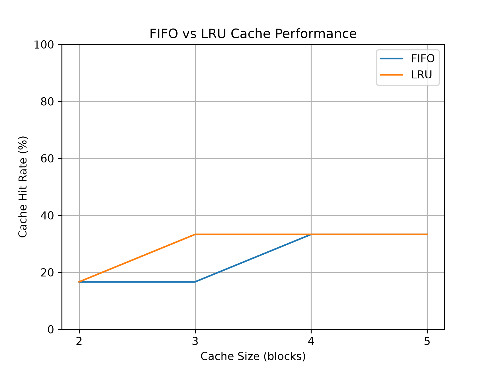

# CPU Cache Simulator and Performance Analysis

## Project Overview
This project is a Python-based CPU cache simulator developed to investigate how different cache replacement policies affect memory access performance.

The simulator implements two cache replacement algorithms:
- First In, First Out (FIFO)
- Least Recently Used (LRU)

## Features
- **FIFO Cache Replacement:** Implements the First In, First Out algorithm, replacing the oldest inserted memory block when the cache reaches capacity.
- **LRU Cache Replacement:** Implements the Least Recently Used algorithm, replacing the block that has not been accessed for the longest time.
- **Cache Performance Analysis:** Calculates cache hits, misses, and hit rates for both algorithms.
- **Average Memory Access Time (AMAT):** Estimates memory access time using configurable hit times and miss penalties.
- **Cache Size Comparison:** Evaluates FIFO and LRU performance across different cache capacities.
- **Data Visualisation:** Uses Matplotlib to generate and save graphs comparing cache hit rates.

## How It Works
The simulator models a simplified, fully associative cache using Python lists. Each memory request is checked against the cache to determine whether it produces a hit or a miss.
Fully associative cache is a type of cache memory where any block of main memory can be stored in any cache line or block, rather than being restricted to a single predetermined location

### 1. FIFO (First In, First Out)
- Checks whether the requested memory block exists in the cache.
- If present, records a cache hit without changing the insertion order.
- If absent, records a cache miss.
- When the cache is full, removes the oldest inserted block before adding the new block.

### 2. LRU (Least Recently Used)
- Checks whether the requested memory block exists in the cache.
- If present, records a cache hit and updates the block's position to indicate its recent use.
- If absent, records a cache miss.
- When the cache is full, removes the least recently used block before inserting the new block.

### 3. Performance Calculations

**Cache Hit Rate**
The percentage of memory requests successfully served by the cache:
Hit Rate (%) = (Cache Hits / Total Memory Requests) × 100

**Average Memory Access Time (AMAT)**
The estimated average time required to access memory:
AMAT = Hit Time + (Miss Rate × Miss Penalty)

The simulator uses assumed timing values rather than measurements from physical CPU hardware.

## Performance Results
The simulator compares FIFO and LRU cache replacement policies across different cache capacities using the same memory request sequence.
The following graph illustrates how cache hit rates vary with cache size.



### Results and Discussion
The simulation investigates how cache capacity and replacement policy influence cache hit rates.

**Key observations:**
- Increasing cache capacity can improve the hit rate by allowing more memory blocks to remain in the cache.
- FIFO and LRU can produce different results because FIFO replaces the oldest inserted block, while LRU replaces the least recently accessed block.
- Neither replacement policy is guaranteed to outperform the other for every memory access sequence.
- A higher hit rate generally reduces the estimated Average Memory Access Time (AMAT), assuming a constant hit time and miss penalty.

**Limitations:** This project uses a simplified, fully associative cache model with fixed timing assumptions. It does not model real CPU features such as cache-line sizes, set associativity.

## How to Run

### Requirements

- Python 3
- Matplotlib library

### Installation

**1. Clone the repository**

```bash
git clone https://github.com/YOUR-USERNAME/CPU-Cache-Simulator.git
```

Replace `YOUR-USERNAME` with your GitHub username.

**2. Open the project folder**

```bash
cd CPU-Cache-Simulator
```

**3. Install Matplotlib**

```bash
python -m pip install matplotlib
```

**4. Run the simulator**

```bash
python "Full working Cache.py"
```

The program will display the cache simulation results in the terminal and generate a graph comparing FIFO and LRU performance.

The graph will also be saved as `cache_performance.png`.

## Future Improvements
Potential extensions to this project include:

- **Additional Replacement Policies:** Implement policies such as Random Replacement and Least Frequently Used (LFU) to compare their performance with FIFO and LRU.
- **Cache Associativity:** Extend the simulator to model direct-mapped and set-associative caches.
- **Multi-Level Cache Hierarchy:** Introduce L1, L2 and L3 caches to investigate how different cache levels affect memory access performance.
